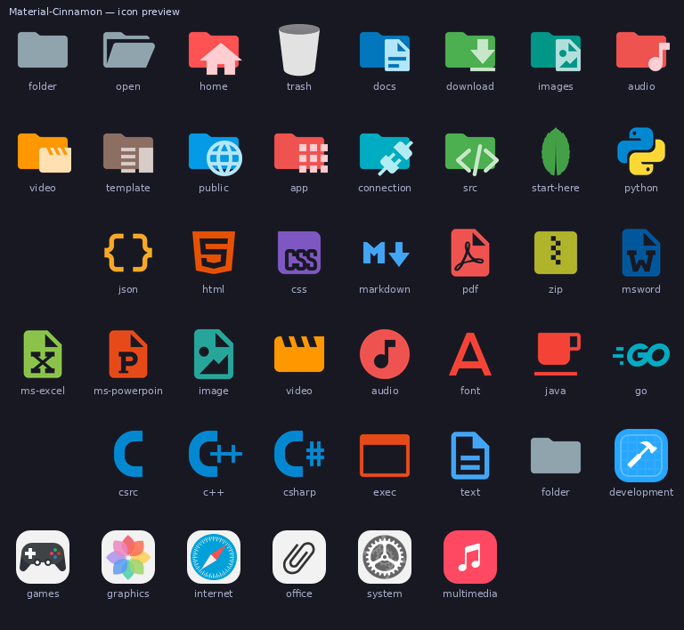
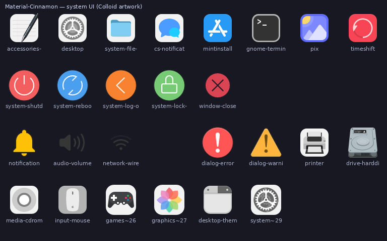

# Material Icons for Cinnamon

A Material Design icon theme for the **Cinnamon** desktop (Linux Mint), generated from
[`material-extensions/vscode-material-icon-theme`](https://github.com/material-extensions/vscode-material-icon-theme).

Cinnamon does not carry icons inside its window themes — the desktop asks a GTK icon theme
for every icon. This project turns the 906 PNG icons shipped with the Material Icon Theme
into a freedesktop-compliant GTK icon theme for files and folders (`places`, `mimetypes`,
nine fixed sizes), and dresses the desktop itself — menus, panel, dialogs, buttons and the
system applications — with the flat
[Colloid icon theme](https://github.com/vinceliuice/Colloid-icon-theme), including
recolourable `-symbolic` variants. Third-party applications are not redrawn: they keep the
vendor icon their package installs into `hicolor`.



## Features

| | |
| --- | --- |
| Upstream | `vscode-material-icon-theme` **v5.39.0** (pinned in `upstream.lock.json`) |
| System UI artwork | `Colloid-icon-theme` (pinned in `upstream-colloid.lock.json`) |
| Icon names | **1866** across 7 contexts |
| Files | 14879 PNGs + 9527 symlinks, 15.2 MB payload |
| Sizes | 16, 22, 24, 32, 48, 64, 96, 128, 256 px (`actions`/`status`: 16–48 px + `symbolic/`) |
| Reference coverage | Mint-Y `places` **38/38**, `mimetypes` **177/177** (third-party file managers excluded) |
| Shell coverage | `actions` **172/181**, `status` **149/152**, `devices` **74/75** of the live desktop's requests |
| Build deps | [uv](https://docs.astral.sh/uv/) + Python 3.10+ (`uv sync`): Pillow and **resvg-py** for SVG rasterisation — no Inkscape |
| Theme size | ~28 MB unpacked |

Application icons the Material set has no artwork for (Firefox, Thunderbird, …) are not
redrawn: they resolve to the vendor icon their package installs into `hicolor`. Names the
theme does ship are never borrowed from a restyled Mint icon — see
[Material UI icons](#material-ui-icons) for the numbers.

## Install

### From a release (recommended)

1. Download `Cinnamon-Mosaic-2.0.0.tar.xz` from the [releases page](../../releases).
2. Extract it into your icon directory:

   ```bash
   mkdir -p ~/.local/share/icons
   tar -xJf Cinnamon-Mosaic-2.0.0.tar.xz -C ~/.local/share/icons
   gtk-update-icon-cache -f -q ~/.local/share/icons/Cinnamon-Mosaic
   ```

3. Pick **Cinnamon-Mosaic** in *Menu → Preferences → Themes → Icons*, or:

   ```bash
   gsettings set org.cinnamon.desktop.interface icon-theme Cinnamon-Mosaic
   nemo -q                                  # restart the file manager
   ```

   The panel and menu pick the change up after `cinnamon --replace &` (or Alt+F2 → `r`).

### From source

```bash
git clone https://github.com/<your-org>/cinnamon-mosaic-icons.git
cd cinnamon-mosaic-icons
uv sync           # creates .venv with Pillow + resvg-py from uv.lock

make build        # -> dist/Cinnamon-Mosaic + dist/Cinnamon-Mosaic-2.0.0.tar.xz
make verify       # index.theme, symlinks, pixel sizes, coverage, GTK lookup
./scripts/install.sh --set
```

`make build` runs `uv sync` itself (the `venv` target), so a fresh clone only needs
`uv`. Without make:

```bash
uv run python scripts/build.py          # build
uv run python scripts/verify.py         # validate
uv run python scripts/build.py --renderer inkscape   # fall back to the Inkscape CLI
```

`make help` lists every target. `make verify-strict` additionally fails when the reference
theme is missing or coverage drops below the threshold (useful on a real Mint install, the
CI job runs without Mint-Y and therefore skips that part).

To uninstall and restore the previously active icon theme:

```bash
./scripts/uninstall.sh
```

## What is inside

```
Cinnamon-Mosaic/
├── index.theme            # Name/Inherits/Directories + one section per size
├── icon-theme.cache       # gtk-update-icon-cache
├── places/{16..256}/      # folders, home, trash, network, file managers, start-here
├── mimetypes/{16..256}/   # file icons resolved from MIME types and extensions
├── apps/ categories/ devices/  # system applications, menu categories, hardware — Colloid
├── actions/{16..48}/      # session, power, window buttons, edit/navigation — Colloid
├── status/{16..48}/       # dialogs, network, audio, notifications — Colloid
├── actions|status|devices/symbolic/   # scalable single-colour SVG for *-symbolic names
├── LICENSE                # GPL-3.0 — the theme as a whole
├── LICENSE-MIT LICENSE-Material LICENSE-Apache-2.0 ATTRIBUTION.md
└── index.theme
```

The theme inherits `Adwaita,hicolor,Mint-Y` by default. Order matters: any name this theme
does not ship falls through the chain, and `hicolor` sits **ahead of** the Mint themes on
purpose, so Firefox, Thunderbird and other apps the Material set has no artwork for keep the
vendor icon their package installs into `/usr/share/icons/hicolor` instead of being redrawn
as a Mint square. `Mint-Y` stays last as a safety net, but since this theme ships the shell's
own `actions`/`status`/`devices` names it only answers third-party applications that no other
installed theme knows.

```bash
python3 scripts/build.py --inherit hicolor,Mint-Y            # vendor icons even more aggressively
python3 scripts/build.py --inherit Mint-Y-Sand,Adwaita,hicolor  # old Mint-first behaviour
python3 scripts/build.py --sizes 16,22,24,32,48,64,96,128,256,512   # add 512px
```

## System UI icons (Colloid)

`vscode-material-icon-theme` is a file-type/brand set: it has no `close`, `check`, `error`,
`wifi` or `battery` glyph, and its application icons are brand logotypes. The desktop side of
the theme — `actions`, `status`, `devices`, `categories` and the system applications — is
therefore answered by [`Colloid`](https://github.com/vinceliuice/Colloid-icon-theme), a flat
theme that is hand-drawn per size and already knows Cinnamon's vocabulary (`cs-*` settings
panels, `xsi-*` shell aliases, `nm-*` NetworkManager indicators, Cinnamon lock keys).

```bash
make vendor-colloid   # resolve mappings/colloid*.tsv against ../Colloid-icon-theme
make vendor-check     # compare assets/colloid + colloid-index.json with the checkout
```

`tools/vendor-colloid-icons.py` indexes Colloid's `src/` artwork and its `links/` alias
overlay, resolves every table row to the drawing made for each size directory
(`16`/`22`/`24`/`32`/`scalable`), and copies just that artwork into `assets/colloid/`
(577 SVGs, 3.1 MB). The resolution is path independent: a checkout whose symlinks were
rewritten to absolute paths produces byte-identical output. `mappings/colloid-index.json`
is the snapshot the build reads; `upstream-colloid.lock.json` pins the source hash.

| Mapping table | Names | Contents |
| --- | ---: | --- |
| `mappings/colloid.tsv` | 353 | curated rows: session/power, dialogs, NetworkManager, audio, notifications, devices, menu categories, system applications, the two trash places |
| `mappings/colloid-auto.tsv` | 214 | generated from `mappings/required.tsv`: every name the live desktop asks for that Colloid answers directly |
| `mappings/apps.tsv` | 5 | curated: Material logotypes reused as application icons (VS Code + its aliases) |
| `mappings/extra.tsv` | 3 | curated artwork in `assets/extra/` that neither source has (the Plank notification bell) |

Every output size is rendered from the Colloid drawing made for it (48 px uses the 32 px
art, applications use the scalable art above 32 px). `actions`, `status` and `devices` also
get a `symbolic/` directory: Colloid's own single-colour SVGs, declared `Type=Scalable`, so
GTK recolours the `*-symbolic` names to the panel's foreground colour.



Third-party applications are deliberately absent — no hand-drawn brand logos — so Chrome,
Blender, Steam, Firefox or Thunderbird are not painted at all and resolve through `hicolor`
to the vendor artwork their package installs. The exceptions are curated rows in
`mappings/apps.tsv`: VS Code, whose `.desktop` asks for `vscode` and whose logo the vendored
Material set already ships as a file icon. Leaving it unmapped is not neutral — the name then
falls through to Mint-Y's restyled rounded square, which is what the launcher used to show.

`tools/collect-required.py` rebuilds `mappings/required.tsv` from the live desktop, and
`build.py --required` reports which theme answers each name:

| context | theme | adwaita | hicolor | Mint-Y | missing | total |
| --- | ---: | ---: | ---: | ---: | ---: | ---: |
| actions | 172 | 0 | 9 | 0 | 0 | 181 |
| status | 149 | 3 | 0 | 0 | 0 | 152 |
| devices | 74 | 1 | 0 | 0 | 0 | 75 |
| apps | 67 | 3 | 91 | 10 | 24 | 195 |

The `apps` row is what "no third-party artwork" looks like: the 128 remaining names belong to
installed third-party packages and resolve to their own icons or to nothing at all.

## How the mappings are made

`icons/file` and `icons/folder` contain the vendored 512×512 PNGs (the upstream project
ships SVG only; `tools/convert.sh` rasterises a checkout into this layout). On top of them,
four sources of icon names are merged, highest priority first:

1. `mappings/mimetypes.tsv` — explicit GTK/MIME names such as `text-x-python`.
2. `/usr/share/mime/globs2` — every MIME type with a `*.ext` glob, resolved through the
   extension table extracted from the upstream TypeScript definitions.
3. `mappings/mime-rules.tsv` — regex fallbacks (`^application/.*(zip|tar|…) → zip`).
4. A final top-level fallback (`text/* → document`, `image/* → image`, …).

`places` additionally exposes every `folder-*` icon under its own name, so
`folder-src.png`, `folder-database.png`, … can be referenced directly. See
[docs/mappings.md](docs/mappings.md) for the table formats and
[docs/theme-layout.md](docs/theme-layout.md) for the theme structure.

## Updating the pinned upstream

```bash
# bump "tag"/"version" in upstream.lock.json first
make vendor             # fetch that tag into vendor/
./tools/convert.sh --upstream vendor/vscode-material-icon-theme   # refresh icons/
make refresh-maps       # re-extract mappings/generated-file-map.json (needs Node)
make build verify
```

## Repository layout

```
├── assets/folder-base.svg     # template used to synthesise folder / folder-open
├── assets/colloid/**/*.svg    # vendored Colloid system UI artwork (577 files, GPL-3.0)
├── docs/                      # mapping + theme documentation, README previews
├── icons/{file,folder}/*.png   # vendored 512x512 sources (906 icons)
├── mappings/                  # hand-written tables + generated colloid index/required lists
├── scripts/                   # build.py, verify.py, install/uninstall, fetch, publish
├── tools/convert.sh           # upstream checkout -> icons/*.png
├── tools/vendor-colloid-icons.py  # colloid.tsv -> assets/colloid + colloid-index.json
├── tools/collect-required.py  # live desktop icon requests -> mappings/required.tsv
├── .github/workflows/         # CI (build + verify) and release (tag -> artifact)
├── dist/                      # build output (not committed)
└── Makefile
```

## Troubleshooting

- **`folder-open` looks like a closed folder** — no SVG rasteriser was available at build time;
  `build.py` degrades gracefully and says so in `dist/report.md`. Install the uv environment
  (`uv sync`) or Inkscape (`--renderer inkscape`).
- **Some icons still look like Mint-Y** — with the default `Adwaita,hicolor,Mint-Y` chain
  only names that neither Adwaita nor hicolor knows fall back to Mint. That is normally a
  third-party application; check `dist/report.md` (*still borrowed*) before assuming a gap.
  The theme's own system UI vocabulary comes from Colloid; `make vendor-colloid` after
  pointing `COLLOID=` at a checkout re-resolves it.
- **An app lost its Mint icon and now shows the vendor logo** — intended. That is what
  `hicolor` ahead of `Mint-Y` means; the Material theme does not redraw third-party brands.
- **Theme does not show up in Settings** — it must live in `~/.local/share/icons` or
  `~/.icons`; restart the Settings dialog after installing.

## License

The **generated theme is GPL-3.0** ([LICENSE](LICENSE)): it redistributes Colloid's GPL-3.0
system-UI artwork, and a work that bundles that artwork must be distributed under the same
licence.

The inputs keep their own terms:

| Path | Licence |
| --- | --- |
| `scripts/`, `tools/`, `Makefile`, `mappings/`, `mime/` | MIT — [LICENSE-MIT](LICENSE-MIT) |
| `icons/`, `assets/folder-base.svg`, `mappings/generated-file-map.json` (Material Icon Theme, Material Extensions) | MIT — [LICENSE-Material](LICENSE-Material) |
| `assets/colloid/` (Colloid) | GPL-3.0 — `assets/colloid/LICENSE` |
| `assets/extra/` (dock bell glyphs) | Apache-2.0 — [LICENSE-Apache-2.0](LICENSE-Apache-2.0) |

MIT and Apache-2.0 artwork may be redistributed inside a GPL-3.0 aggregate; the per-source
notices stay in force, so `make build` copies `LICENSE`, `LICENSE-MIT`, `LICENSE-Material`,
`LICENSE-Apache-2.0`, `LICENSE-Colloid` and `ATTRIBUTION.md` into `dist/Cinnamon-Mosaic/`.
See [ATTRIBUTION.md](ATTRIBUTION.md).

---

[中文说明](README.zh-CN.md)
