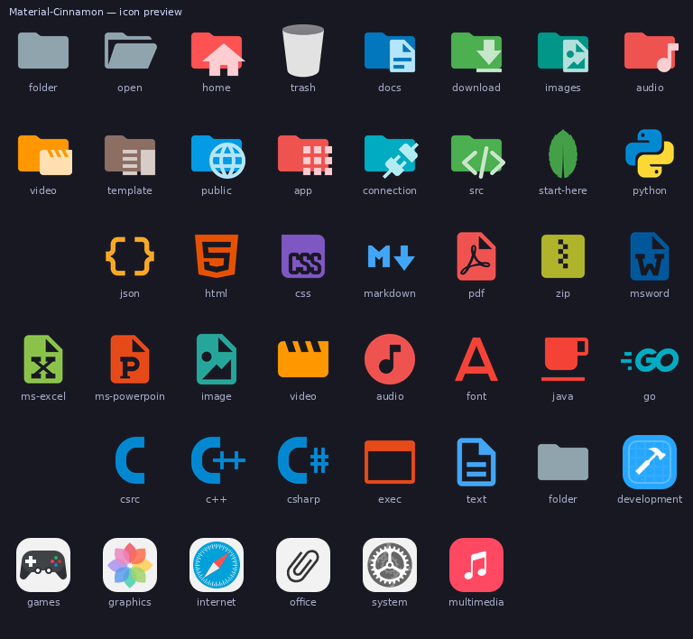
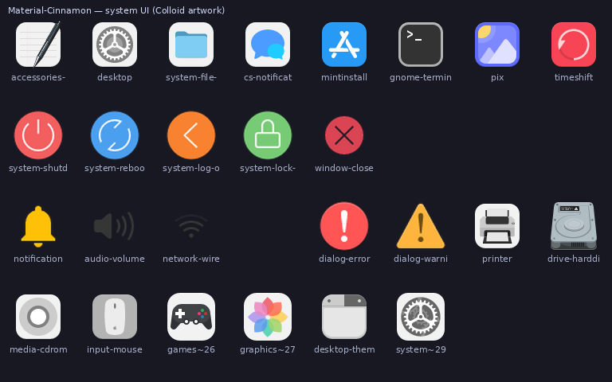

# Material Icons for Cinnamon（中文说明）

把 [`vscode-material-icon-theme`](https://github.com/material-extensions/vscode-material-icon-theme)
的 906 个图标打包成 **Cinnamon 桌面（Linux Mint）可直接选用的 GTK 图标主题**。

Cinnamon 的窗口主题不带图标——桌面通过 GTK 图标主题取图标。本项目把这些图标整理成
freedesktop 规范的主题：文件与文件夹（`places`、`mimetypes`）继续用 Material 的图案，
桌面本身（菜单、面板、对话框、按钮、系统软件，即 `actions`、`status`、`devices`、
`categories`、`apps`）换成 [Colloid 图标](https://github.com/vinceliuice/Colloid-icon-theme)，
并带可着色的 `-symbolic` 变体。第三方软件一律不重绘，直接用各自装进 `hicolor` 的原厂图标。

继承链固定为 `Inherits=Adwaita,hicolor,Mint-Y`：本主题没收的图标名优先落回 `hicolor`
里各软件自带的官方图标（Firefox、Thunderbird 等保持原厂 logo），`Mint-Y` 排在最后兜底。



## 包含什么

| 项目 | 数值 |
| --- | --- |
| 上游版本 | `vscode-material-icon-theme` **v5.39.0**（固定在 `upstream.lock.json`） |
| 系统 UI 图标来源 | `Colloid-icon-theme`（固定在 `upstream-colloid.lock.json`） |
| 图标名 | **1866** 个，7 个 context |
| 文件 | 14879 个 PNG + 9527 个软链，有效载荷 15.2 MB |
| 尺寸 | 16, 22, 24, 32, 48, 64, 96, 128, 256（`actions`/`status` 到 48，另有 `symbolic/`） |
| 参考主题覆盖率 | Mint-Y `places` **38/38**、`mimetypes` **177/177**（第三方文件管理器不计） |
| 壳层覆盖 | 当前桌面请求的名字：`actions` **172/181**、`status` **149/152**、`devices` **74/75** |
| 构建依赖 | [uv](https://docs.astral.sh/uv/) + Python 3.10+（`uv sync` 装 Pillow 与 **resvg-py**）——不再需要 Inkscape |
| 主题体积 | 解包后约 28 MB |

### 系统 UI 用 Colloid 补齐

`vscode-material-icon-theme` 是文件类型/品牌图标集，没有 `close`、`error`、`wifi`、
`battery` 这类语义图标，应用图标也是品牌 logo。所以桌面那一半（`actions`、`status`、
`devices`、`categories`、`apps`）改由
[Colloid](https://github.com/vinceliuice/Colloid-icon-theme) 提供——它每个尺寸都是单独画的，
而且本来就认识 Cinnamon 的词汇（`cs-*` 设置面板、`xsi-*` 壳层别名、`nm-*` 网络指示器、
Cinnamon 的锁键图标）。

```bash
make vendor-colloid   # 用 ../Colloid-icon-theme 解析 mappings/colloid*.tsv
make vendor-check     # 比对 assets/colloid 与 colloid-index.json
make required         # 从当前桌面采集真实请求的图标名到 mappings/required.tsv
python3 scripts/build.py --required mappings/required.tsv   # 逐名称归属报告
```

`tools/vendor-colloid-icons.py` 会索引 Colloid 的 `src/` 画稿与 `links/` 别名层，把每一行
映射解析到对应尺寸目录（`16`/`22`/`24`/`32`/`scalable`）的画稿，只把用到的抄进
`assets/colloid/`（577 个 SVG，3.1 MB）。解析与路径无关：即使 checkout 的软链被改写成
绝对路径，产出也逐字节一致。构建读的是快照 `mappings/colloid-index.json`，
`upstream-colloid.lock.json` 记录来源哈希。

| 映射表 | 行数 | 内容 |
| --- | ---: | --- |
| `mappings/colloid.tsv` | 353 | 人工整理：电源/会话、对话框、NetworkManager、音量、通知、设备、菜单分类、系统软件、两个回收站 places |
| `mappings/colloid-auto.tsv` | 214 | 由 `required.tsv` 自动生成：当前桌面真正请求、且 Colloid 直接有的名字 |
| `mappings/apps.tsv` | 5 | 人工整理：把 Material 里已有的品牌图标复用为应用图标（VS Code 及其别名） |
| `mappings/extra.tsv` | 3 | 人工整理：两个来源都没有的图，画在 `assets/extra/`（Plank 通知铃铛） |

每个输出尺寸都用 Colloid 为该尺寸画的稿（48 px 用 32 px 稿，应用图标 32 px 以上用 scalable）。
`actions`、`status`、`devices` 另有 `symbolic/` 目录，放 Colloid 原生的单色 SVG，
`Type=Scalable`，GTK 会把 `*-symbolic` 名字染成面板前景色。



第三方软件刻意不手绘品牌图标：Chrome、Blender、Steam、Firefox、Thunderbird 等一律经
`hicolor` 落到各自安装的原厂图标。例外是 `mappings/apps.tsv` 里人工整理的那几行——VS Code：
它的 `.desktop` 请求 `vscode`，而 Material 图标集本来就带这个蓝色标志（文件图标同名）。
不映射并不等于「保持原样」：名字会继续往下落到 Mint-Y 的圆角方框图标，也就是启动器里一直
看到的那个方块。

## 安装

### 用 Release 包（推荐）

```bash
mkdir -p ~/.local/share/icons
tar -xJf Cinnamon-Mosaic-2.0.0.tar.xz -C ~/.local/share/icons
gtk-update-icon-cache -f -q ~/.local/share/icons/Cinnamon-Mosaic

# 切换（或在 菜单 → 首选项 → 主题 → 图标 里选 Cinnamon-Mosaic）
gsettings set org.cinnamon.desktop.interface icon-theme Cinnamon-Mosaic
nemo -q                     # 重启文件管理器
```

面板与菜单需要 `cinnamon --replace &`（或 Alt+F2 → `r`）才会全部刷新。

### 从源码构建

```bash
git clone https://github.com/<your-org>/cinnamon-mosaic-icons.git
cd cinnamon-mosaic-icons
uv sync           # 按 uv.lock 建 .venv（Pillow + resvg-py）

make build        # 生成 dist/Cinnamon-Mosaic 与 dist/Cinnamon-Mosaic-2.0.0.tar.xz
make verify       # 校验 index.theme、软链、像素尺寸、覆盖率、GTK 查找
./scripts/install.sh --set
```

`make build` 会先自动跑 `uv sync`（`venv` 目标），所以新克隆只需要装 `uv`。不用 make 时：

```bash
uv run python scripts/build.py          # 构建
uv run python scripts/verify.py         # 校验
uv run python scripts/build.py --renderer inkscape   # 退回 Inkscape CLI 渲染
```

其余目标见 `make help`；`make verify-strict` 会在参考主题缺失或覆盖率不足时直接失败
（适合本机 Mint 环境，CI 里没有 Mint-Y，默认跳过这一段）。

卸载并恢复原图标主题：

```bash
./scripts/uninstall.sh
```

## 映射是怎么来的

`icons/file` 与 `icons/folder` 是 512×512 的 PNG 源（上游只有 SVG，`tools/convert.sh`
可从上游 checkout 重新生成）。在此之上按优先级合并四类名字：

1. `mappings/mimetypes.tsv`：GTK/MIME 精确名（如 `text-x-python`）；
2. `/usr/share/mime/globs2`：由 MIME 的 `*.ext` 经扩展名表推导；
3. `mappings/mime-rules.tsv`：正则兜底（`^application/.*(zip|tar|…) → zip`）；
4. 顶层兜底（`text/* → document`、`image/* → image`…）。

`places` 还会把全部 `folder-*` 图标以自身名字暴露，可直接引用 `folder-src.png` 等。
细节见 [docs/mappings.md](docs/mappings.md) 与 [docs/theme-layout.md](docs/theme-layout.md)。

## 更新上游

```bash
# 先改 upstream.lock.json 里的 tag/version
make vendor
./tools/convert.sh --upstream vendor/vscode-material-icon-theme
make refresh-maps      # 需要 Node
make build verify
```

## 目录结构

```
├── assets/folder-base.svg      # 合成 folder / folder-open 的模板
├── assets/colloid/**/*.svg     # 随仓库提交的 Colloid 系统 UI 画稿（577 个，GPL-3.0）
├── docs/                       # 映射与主题结构文档、README 预览图
├── icons/{file,folder}/*.png    # 906 个 512×512 源图标
├── mime/                       # 用户级 MIME 覆盖：让 PDF/Markdown 用回自己的图标名
├── mappings/                   # 手工映射表 + 自动生成的 colloid 索引/required 快照
├── scripts/                    # build.py / verify.py / install / install-mime-icons / uninstall / fetch / publish
├── tools/convert.sh            # 上游 checkout → icons/*.png
├── tools/vendor-colloid-icons.py  # colloid.tsv → assets/colloid + colloid-index.json
├── tools/collect-required.py   # 当前桌面请求的图标名 → mappings/required.tsv
├── .github/workflows/          # CI（构建+校验）与 Release（打 tag 出包）
├── dist/                       # 构建产物（不入库）
└── Makefile
```

## 常见问题

- **`folder-open` 看起来是闭合的文件夹**：构建时没有任何 SVG 渲染器，脚本会降级并在
  `dist/report.md` 里注明。装好 uv 环境（`uv sync`）或用 `--renderer inkscape`。
- **部分图标还是 Mint-Y 的样子**：继承链在起作用，通常意味着那是第三方软件。先看
  `dist/report.md` 的「still borrowed」；系统 UI 的名字由 Colloid 覆盖，换新画稿只需
  `COLLOID=... make vendor-colloid`。
- **主题列表里看不到**：主题必须在 `~/.local/share/icons` 或 `~/.icons` 下，装完重开设置窗口。
- **PDF（或 Markdown）显示成 Word 图标**：装过会改写共享 MIME 数据库的软件（Obsidian 是典型）。
  `obsidian.xml` 把 `application/pdf`、`text/markdown` 的 `<icon>` 声明成了通用的
  `x-office-document`，而 GLib 会把这个显式声明的名字排在按 MIME 推导出的
  `application-pdf` / `text-markdown` 之前；GTK 应用（Nemo 等）于是永远取到
  `x-office-document`——本主题里那正是 Word 图标。跑
  `./scripts/install-mime-icons.sh`（或 `make mime-icons`）在用户级 MIME 库里把这些名字
  改回来即可，不需要 root，也不动系统包；装完 `nemo -q` 重开文件管理器生效。

## 许可

**生成出来的主题整体是 GPL-3.0**，见 [LICENSE](LICENSE)：它再分发了 Colloid 的 GPL-3.0
系统 UI 画稿，而包含该画稿的作品必须按同一许可证分发。

各个输入保留自己的条款：

| 路径 | 许可 |
| --- | --- |
| `scripts/`、`tools/`、`Makefile`、`mappings/`、`mime/` | MIT — [LICENSE-MIT](LICENSE-MIT) |
| `icons/`、`assets/folder-base.svg`、`mappings/generated-file-map.json`（Material Icon Theme，Material Extensions） | MIT — [LICENSE-Material](LICENSE-Material) |
| `assets/colloid/`（Colloid） | GPL-3.0 — `assets/colloid/LICENSE` |
| `assets/extra/`（dock 铃铛图标） | Apache-2.0 — [LICENSE-Apache-2.0](LICENSE-Apache-2.0) |

MIT / Apache-2.0 画稿可以被并入 GPL-3.0 的聚合作品再分发，逐项声明继续有效；`make build`
会把 `LICENSE`、`LICENSE-MIT`、`LICENSE-Material`、`LICENSE-Apache-2.0`、`LICENSE-Colloid`
和 `ATTRIBUTION.md` 一起复制进 `dist/Cinnamon-Mosaic/`。详见 [ATTRIBUTION.md](ATTRIBUTION.md)。

---

[English](README.md)
